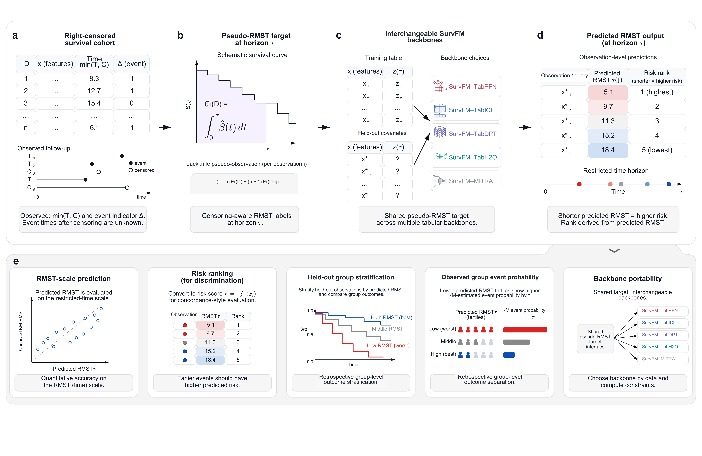

# SurvFM

<p class="product-kicker">Survival prediction with reusable tabular backbones</p>

<div class="research-notice">
<strong>Research software.</strong> SurvFM is intended for methodological
research and retrospective evaluation. It has not been validated for clinical
decision-making.
</div>

SurvFM is a model-agnostic framework that adapts tabular prediction models to
right-censored survival outcomes. It constructs jackknife pseudo-observation
targets for restricted mean survival time (RMST), then supplies the same
horizon-specific regression task to interchangeable tabular backbones.

[Install SurvFM](installation.md){ .md-button .md-button--primary }
[View the source](https://github.com/yuelyu21/SurvFM){ .md-button }

{ .hero-figure }

<div class="workflow-grid">
  <div class="workflow-step"><strong>1. Define the horizon</strong><br>Use a clinically relevant restriction time with adequate follow-up support, or a training-fold event-time quantile for benchmarking.</div>
  <div class="workflow-step"><strong>2. Construct targets</strong><br>Convert censored training outcomes into exact jackknife pseudo-RMST labels.</div>
  <div class="workflow-step"><strong>3. Fit a backbone</strong><br>Use TabPFN by default, select another registered backbone, or supply a custom regressor.</div>
</div>

```python
from survfm import fit_survfm

model = fit_survfm(
    X_train,
    time_train,
    event_train,
    backbone="tabpfn",
    tau=365.0,
)

predicted_rmst = model.predict(X_test)
risk_score = model.predict_risk(X_test)
```

## Scope

- Static baseline covariates and a binary first-event endpoint.
- Horizon-specific predictions targeting covariate-conditional RMST.
- Exact, clipped jackknife pseudo-observations matching the manuscript workflow.
- Train-only mixed-data preprocessing for pandas DataFrames.
- Local and hosted backbones through one estimator API.

## What a prediction means

A SurvFM prediction targets the expected event-free time accumulated up to the
chosen horizon among observations with similar baseline characteristics. It is
expressed in the original time units and is not an individual's predicted event
date. Negative predicted RMST can be used when a higher-is-riskier score is
needed for concordance evaluation.

## Naming

- **SurvFM** names the model-agnostic framework.
- **Pseudo-RMST target construction** names the statistical mechanism used to
  transform censored follow-up into regression labels.
- **SurvFM-TabPFN**, **SurvFM-TabICL** and related labels identify SurvFM paired
  with a particular tabular backbone.
